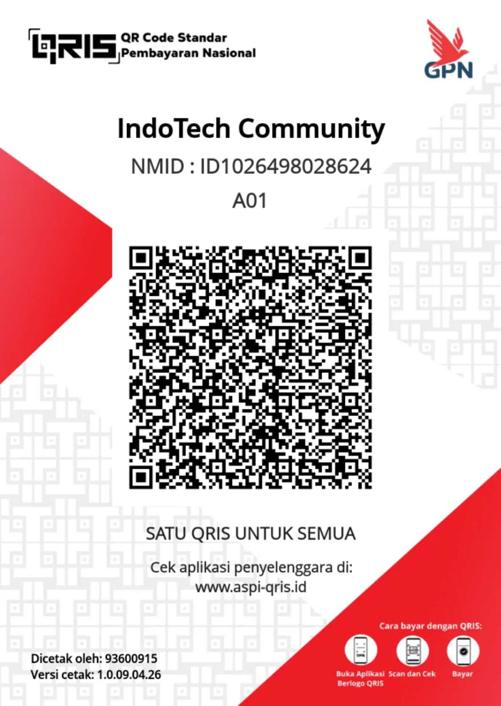

> 📚 **Dokumentasi:** [Indeks lengkap ID/EN](DOCS.md) · [English documentation index](DOCS.en.md)

<div align="center">

# IndoTech-Absensi V1


### Aplikasi Presensi Karyawan Berbasis Web dan APK — Geofence, Verifikasi Wajah, Jadwal & Shift, Pengajuan Izin, dan Laporan Administrator.

[](LICENSE)
[](#)
[](#)
[](#)
[](#)
[](https://github.com/Ismail-IndoTech)

**Versi pertama dari lini aplikasi absensi IndoTech: presensi harian dengan validasi lokasi, deteksi wajah di sisi klien, penjadwalan kerja, pengajuan izin/lembur/tukar shift, dan panel administrator terpadu.**

</div>

---

## 📖 Ringkasan

**IndoTech-Absensi V1** adalah aplikasi absensi karyawan berbasis **Laravel 12 + Livewire 3** yang menyediakan dua antarmuka dalam satu basis kode:

1. **Panel Administrator** — mengelola data master (karyawan, divisi, jabatan, lokasi absensi, radius, jadwal, shift, hari libur), meninjau laporan presensi, dan memproses pengajuan karyawan.
2. **Panel Karyawan** — melakukan absen masuk/pulang, melihat riwayat, mengajukan izin/lembur/perubahan jadwal, dan memantau jadwal kerja.

Aplikasi ini juga menyediakan **landing page unduhan APK** (`/download-app`) serta modul **API** untuk kebutuhan aplikasi mobile, dengan pembatasan perangkat (*device binding*) dan audit log aktivitas.

---

## ✨ Fitur Utama

### Absensi & Validasi
- Absen **masuk** dan **pulang** dengan validasi jadwal (tidak boleh check-in lebih dari 45 menit sebelum jam masuk, check-out minimal 30 menit setelah check-in, dan batas maksimal 8 jam setelah jadwal berakhir).
- **Deteksi wajah** di browser menggunakan `face-api.js` (model tersedia lokal di `public/models`).
- **Validasi lokasi** dengan peta **Leaflet + OpenStreetMap**, geofence radius kantor, dan pengecekan akurasi GPS.
- Dukungan **shift lintas hari** (`next_day`), termasuk penentuan jadwal aktif berdasarkan presensi hari sebelumnya.
- Deteksi indikasi **mock location** pada halaman presensi.

### Penjadwalan
- Master **jadwal tetap** dan **shift** beserta pola jadwal (`schedule_patterns`, `shift_patterns`, `shift_groups`).
- **Pengajuan perubahan jadwal** dan **tukar shift** oleh karyawan, dengan alur persetujuan administrator.
- Master **hari libur** yang diperhitungkan dalam perhitungan presensi.

### Pengajuan Karyawan
- Pengajuan **izin/sakit/cuti**, **lembur**, dan **lembur di luar jadwal**.
- Status pengajuan dan riwayat pengajuan pada panel karyawan.
- Persetujuan/penolakan pengajuan melalui panel administrator.

### Administrasi & Pelaporan
- Laporan presensi dan laporan pengajuan.
- **Impor data karyawan** dari berkas spreadsheet (modul `App\Imports`).
- Master data karyawan, divisi, jabatan, sub-jabatan, lokasi absensi, dan radius.
- **Activity audit log** (`app_logs`) untuk aktivitas login dan presensi.
- **Notifikasi** untuk karyawan (web dan API).

### Keamanan
- Dua guard autentikasi terpisah: `admin` (tabel `users`) dan `employee` (tabel `employees`).
- **Device binding** menggunakan UUID perangkat; karyawan tidak dapat login dari perangkat lain.
- Pembatasan **User-Agent** pada Android: karyawan diarahkan memakai aplikasi, bukan browser biasa.
- **Pembatasan percobaan login**: 3 kegagalan per email (blokir 60 detik) dan 5 email berbeda per IP (blokir 15 menit).
- **Pemeriksaan versi aplikasi** melalui middleware `CheckAppVersion` (minimal versi dapat diatur lewat `config('app.min_app_version')`).
- **Deteksi root** pada alur login (`rootDetected`) untuk mengarahkan pengguna ke penanganan khusus.

---

## 👥 Peran Pengguna

| Peran | Guard | Akses |
|-------|-------|-------|
| Administrator | `admin` | Panel `/admin/*`: laporan presensi, perizinan, master data, impor karyawan, pengelolaan pengguna. |
| Karyawan | `employee` | Dashboard, presensi, riwayat, jadwal, pengajuan, profil. |

---

## 🛠️ Teknologi

- **Backend**: PHP 8.2+, Laravel 12, Livewire 3, Laravel Sanctum
- **Frontend**: Blade, Tailwind CSS 3, Vite 6, Alpine.js (bawaan Livewire)
- **Presensi**: `face-api.js` (deteksi wajah), Leaflet + OpenStreetMap, Geolocation API
- **Database**: MariaDB/MySQL (default `mariadb` pada `.env.example`)
- **Tambahan**: `jenssegers/agent` (deteksi perangkat), PhpSpreadsheet (impor Excel), PHPUnit 11

---

## ✅ Persyaratan

- PHP **8.2+** dengan ekstensi `bcmath`, `ctype`, `curl`, `dom`, `fileinfo`, `gd`, `mbstring`, `openssl`, `pdo_mysql`, `tokenizer`, `xml`, `zip`
- Composer 2.x
- Node.js 18+ dan NPM
- MariaDB/MySQL
- Web server (Apache/Nginx) atau `php artisan serve` untuk pengembangan

---

## 🚀 Instalasi Cepat

```bash
# 1. Clone repositori (private)

git clone https://github.com/Ismail-IndoTech/IndoTech-Absensi_V1.git
cd IndoTech-Absensi_V1

# 2. Dependensi backend

composer install

# 3. Konfigurasi environment

cp .env.example .env
php artisan key:generate

# 4. Sesuaikan koneksi database pada .env

#    DB_CONNECTION=mariadb

#    DB_DATABASE=absensi_gsg

#    DB_USERNAME=...  DB_PASSWORD=...


# 5. Migrasi dan data awal

php artisan migrate --seed

# 6. Tautkan storage untuk foto presensi

php artisan storage:link

# 7. Dependensi frontend dan build aset

npm install
npm run build

# 8. Jalankan

php artisan serve
```

Buka `http://127.0.0.1:8000`. Halaman unduhan APK tersedia di `/download-app`.

> **Penting:** `DatabaseSeeder` memuat data contoh administrator dan karyawan. Tinjau dan sesuaikan isinya sebelum dijalankan pada lingkungan produksi, lalu ganti seluruh kredensial bawaan.

Panduan langkah demi langkah tersedia di **[docs/PANDUAN_INSTALASI.md](docs/PANDUAN_INSTALASI.md)**.

---

## ▶️ Menjalankan Saat Pengembangan

```bash
# Server, queue listener, dan Vite sekaligus

composer run dev
```

Atau secara terpisah:

```bash
php artisan serve
npm run dev
php artisan queue:work
```

`QUEUE_CONNECTION` default adalah `database`, sehingga worker diperlukan bila fitur antrean digunakan.

---

## 📂 Struktur Proyek

```text
IndoTech-Absensi_V1/
├── app/
│   ├── Http/
│   │   ├── Controllers/          # Auth, Admin, User, Api
│   │   └── Middleware/           # CheckAppVersion, LoginAttempt, CheckDeviceType
│   ├── Imports/                  # Impor data karyawan (spreadsheet)
│   ├── Livewire/
│   │   ├── Admin/                # Dashboard, master data, laporan
│   │   └── User/                 # Presensi, riwayat, jadwal, pengajuan, profil
│   ├── Models/                   # Employee, Attendance, Schedule, Shift, dll.
│   └── Traits/
├── config/                       # Konfigurasi aplikasi & autentikasi
├── database/
│   ├── migrations/               # Skema presensi, jadwal, shift, pengajuan
│   └── seeders/                  # Data awal
├── public/
│   ├── models/                   # Model face-api.js
│   ├── app-mobile/               # Landing page & berkas APK
│   ├── admin/ · user/ · auth/    # Aset antarmuka
│   └── index.php
├── resources/
│   ├── css/ · js/
│   └── views/                    # Blade: admin, user, auth, components
├── routes/
│   ├── web.php                   # Rute admin & karyawan
│   ├── api.php                   # Rute API (notifikasi, token)
│   └── console.php
├── storage/
└── tests/
```

---

## 🔄 Alur Presensi Singkat

1. Karyawan login (guard `employee`) dengan UUID perangkat yang terikat.
2. Halaman presensi memuat kamera, peta, radius kantor, dan model deteksi wajah.
3. Tombol absen aktif setelah kamera siap, peta siap, wajah terdeteksi, dan lokasi valid.
4. Data dikirim ke `POST /absensi` (atau `POST /absensiOvTm` untuk lembur), disimpan sebagai `Attendance` beserta foto (base64 → `storage/app/public`) dan koordinat.
5. Sistem menentukan status masuk/pulang berdasarkan jadwal atau shift aktif, termasuk shift lintas hari.
6. Setiap aktivitas penting dicatat pada `app_logs`.

Detail aturan dan modul dijelaskan di **[docs/PANDUAN_FITUR.md](docs/PANDUAN_FITUR.md)**.

---

## 🔌 API & Notifikasi

- Token API dibuat melalui `App\Http\Controllers\Api\AuthController` (Laravel Sanctum).
- Endpoint notifikasi: `GET /api/notifications`, `POST /api/notifications/{id}/read`, `POST /api/notifications/{id}/respond`.
- Rute API menggunakan middleware `auth:api` dan `check.app.version`; pastikan guard/middleware tersebut dikonfigurasi sesuai kebutuhan deployment sebelum dipakai di produksi.

---

## 🔐 Catatan Keamanan

- Jangan meng-commit `.env`, kredensial, atau data pribadi karyawan.
- Tinjau `database/seeders/DatabaseSeeder.php` — berkas ini berisi data contoh yang bersifat sensitif dan **tidak untuk produksi apa adanya**.
- Ganti seluruh kata sandi bawaan dan aktifkan HTTPS pada deployment.
- Deteksi wajah dan validasi lokasi di sisi klien adalah lapisan tambahan, bukan pengganti validasi server.

---

## 📚 Dokumentasi

- 📖 **[Panduan Instalasi & Deployment](docs/PANDUAN_INSTALASI.md)**
- 📖 **[Panduan Fitur & Alur Kerja](docs/PANDUAN_FITUR.md)**

---

## 💖 Kontribusi & Donasi

Jika aplikasi ini mempermudah operasional IT, DevOps, dan pengelolaan server di perusahaan atau proyek pribadi Anda, dukung pengembangannya dengan menjadi kontributor atau **Donatur Spesial**.  
*(Donatur dan Sponsor resmi akan kami cantumkan logo perusahaannya di repositori ini).*

Dukung pemeliharaan berkelanjutan, riset modul bypass panel baru, dan pembaruan sistem dengan berdonasi melalui:

<div align="center">

**DANA — 08121600058** (a.n. Mochamad Ismail Soleh)



*Pindai dengan aplikasi DANA, BCA, Mandiri, GoPay, OVO, atau aplikasi pembayaran QRIS apa pun di Indonesia.*

</div>

Semua dana dialokasikan untuk biaya infrastruktur riset server, lisensi alat pengujian, dan pengembangan modul open-source IndoTech. Jika Anda atau institusi Anda ingin menjadi mitra resmi atau sponsor, silakan hubungi kami. Terima kasih atas dukungan Anda!

---

## 📄 Lisensi

Proyek ini dirilis di bawah lisensi terbuka [MIT License](LICENSE).  
Hak cipta © 2026 **Mochamad Ismail Soleh (Ismail.IndoTech)**.

<div align="center">

Dibuat dengan ❤️ oleh [**Ismail.IndoTech**](https://it-app.id) · [it-app.id](https://it-app.id)

</div>